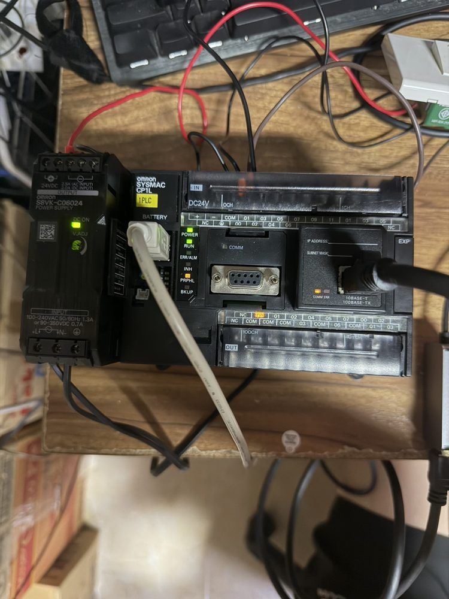
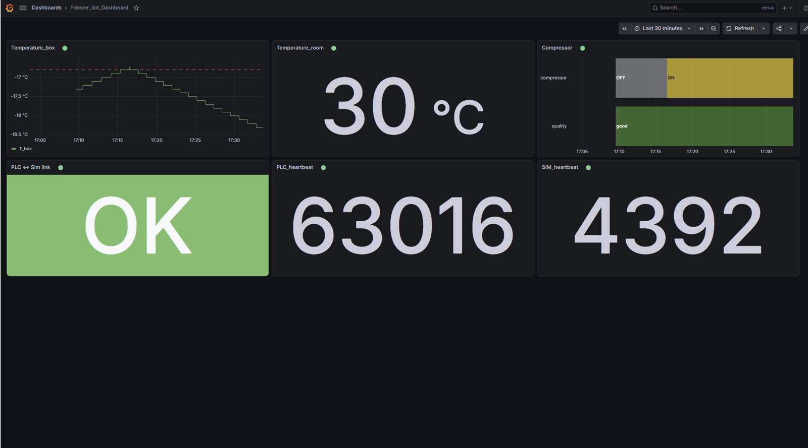
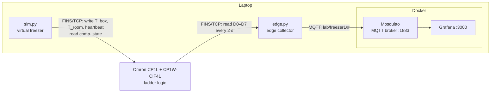

# Freezer Control & IIoT Monitoring

An Omron CP1L PLC controls a virtual freezer written in Python over Omron FINS/TCP. An edge collector streams the PLC data to MQTT, and Grafana shows it live.

The project goes from problem to running system: model the freezer, choose the control strategy from simulation, implement it in ladder logic on a real PLC, then make the data visible.





## Architecture



- **OT network** (laptop ↔ PLC): 192.168.250.0/24 over a USB-Ethernet adapter, no gateway.
- **IT network**: laptop Wi-Fi, kept separate from the PLC network.
- The PLC makes every control decision. `sim.py` only plays the freezer, so the PLC logic is tested in closed loop without real refrigeration hardware (virtual commissioning).

## Results

| Step | What I did | Result |
|---|---|---|
| On/off band | Swept the hysteresis band from 0.5 to 5 K in a lumped thermal model (`band_sweep.py`) | Chose 2.5 K: 13 compressor starts per 12 h vs. 63 at 0.5 K. Run time is ~48% at every band, so the band trades compressor wear for temperature swing, not energy. |
| PI control | Compared on/off with PI, with and without anti-windup (`pid_sim.py`) | Without clamping, integrator windup drove the cabinet to −45.6 °C against a −18 °C setpoint; with clamping it settles at −18.0 °C. The PLC still uses on/off: with a fixed-speed compressor, PI would only switch it more often. |
| Frost indicator | Simulated frost build-up on the evaporator coil (`ice_sim.py`) | Temperature hides frost because the controller compensates by running longer. Duty cycle over 4 h windows crosses a proposed 80% alarm at ~20 h; temperature leaves the band only at ~43 h, about a day later. |
| PLC control | Ladder logic on a real CP1L (`freezer_iot_Ladder.cxp`) | On/off control, 3-minute anti-short-cycle delay, communication watchdog, fail-safe fallback cooling. |
| Data pipeline | FINS/TCP client written from raw sockets (`fins.py`), edge collector to MQTT, Grafana dashboard | Live dashboard of temperatures, compressor state, heartbeats and link status. |

## Ladder logic

1. **On/off control**: compressor on above setpoint + band/2, off below setpoint − band/2.
2. **Anti-short-cycle**: at least 3 minutes before the compressor may restart. This layer applies in every mode.
3. **PLC heartbeat**: D5 counts up every second, so clients can tell the program is running.
4. **Watchdog**: if `sim_heartbeat` (D6) stops changing for more than 10 s, set `comm_fault` (D7).
5. **Fail-safe fallback**: on `comm_fault`, run the compressor 12 min on / 8 min off (60% duty). For a freezer, stopping the compressor is not the safe state: the goods would thaw. 60% sits above the normal ~48% duty to cover unknown load.

## Tests

On the real CP1L:

| Case | Expected | Observed |
|---|---|---|
| PLC running, `sim.py` not started | No sim heartbeat → `comm_fault` → fallback cooling | ✅ |
| Start `sim.py` | `comm_fault` clears, PLC controls by temperature, compressor turns on, T_box falls | ✅ |
| Start `edge.py` | 8 MQTT topics published with `q = good` | ✅ |

With `fake_plc.py` (simplified on/off logic, no anti-short-cycle) and time × 60: duty on the dashboard ≈ 48%, matching the hand calculation.

## Register map (CP1L DM area)

| DM | Name | Written by | Read by | Scaling |
|---|---|---|---|---|
| D0 | T_box | sim.py | ladder, edge | signed, ×10 °C |
| D1 | T_room | sim.py | ladder, edge | signed, ×10 °C |
| D2 | setpoint | set once (−180) | ladder, edge | signed, ×10 °C |
| D3 | band | set once (25) | ladder, edge | signed, ×10 K |
| D4 | comp_state | ladder | sim.py, edge | 0/1 |
| D5 | plc_heartbeat | ladder | edge | unsigned counter |
| D6 | sim_heartbeat | sim.py | ladder | unsigned counter |
| D7 | comm_fault | ladder | edge | 0/1 |

MQTT payload on `lab/freezer1/<metric>`:

```json
{"ts": "2026-11-28T13:20:05+07:00", "value": -18.2, "unit": "degC", "q": "good"}
```

`q` becomes `stale` when the PLC heartbeat stops changing. An open TCP connection only proves the PLC firmware answers FINS. It does not prove the ladder program is running.

## Design decisions

- **FINS/TCP, not Modbus TCP**: the CP1L has no built-in Ethernet. The CP1W-CIF41 board supports FINS/TCP, while Modbus TCP would need an extra adapter. The protocol code is isolated in `fins.py`, so switching to Modbus TCP later only changes that layer.
- **PLC as server, two separate clients**: `sim.py` and `edge.py` each hold their own connection, so the monitoring side can fail without touching control.
- **Grafana reads MQTT directly**: good for a live view, but there is no history yet (see next steps).

## Repository layout

| File | Purpose |
|---|---|
| `freezer_sim.py`, `band_sweep.py` | Thermal model with on/off control; band vs. compressor starts |
| `pid_sim.py` | On/off vs. PI, anti-windup clamping |
| `ice_sim.py` | Frost build-up and duty-cycle indicator |
| `freezer_iot_Ladder.cxp` | CX-Programmer project for the CP1L |
| `fins.py` | FINS/TCP client: handshake, memory area read/write frames |
| `sim.py` | Virtual freezer in closed loop with the PLC |
| `edge.py` | Reads D0–D7 every 2 s and publishes to MQTT |
| `fake_plc.py`, `client_test.py` | Fake FINS server and test client, to run everything without hardware |
| `freezer_dashboard.json` | Grafana dashboard export |
| `docker-compose.yml`, `mosquitto/` | Mosquitto broker |
| `CABLE_DAY.md` | Bring-up checklist for the real PLC (in Thai) |

## Running it

Without hardware:

```bash
pip install -r requirements.txt
docker compose up -d                 # Mosquitto
python fake_plc.py                   # terminal 1
python sim.py 127.0.0.1 60           # terminal 2, time × 60 (fake PLC only)
python edge.py                       # terminal 3
```

With the real PLC (192.168.250.1, FINS/TCP port 9600), load `freezer_iot_Ladder.cxp`, set D2 = −180 and D3 = 25, then:

```bash
python sim.py 192.168.250.1
python edge.py 192.168.250.1
```

Grafana runs in Docker with the `grafana-mqtt-datasource` plugin (broker URI `tcp://host.docker.internal:1883`); import `freezer_dashboard.json`.

## Limits and next steps

- The freezer is simulated. Next: a real cabinet with NTC sensors, a current clamp and a door switch.
- No database yet. Next: a time-series database, so duty cycle can be computed over 4 h windows as designed.
- No store-and-forward or MQTT authentication/TLS yet.
- The thermal model is a single lumped mass. Real air temperature moves faster than the goods, so real compressor cycling will be more frequent than simulated.
